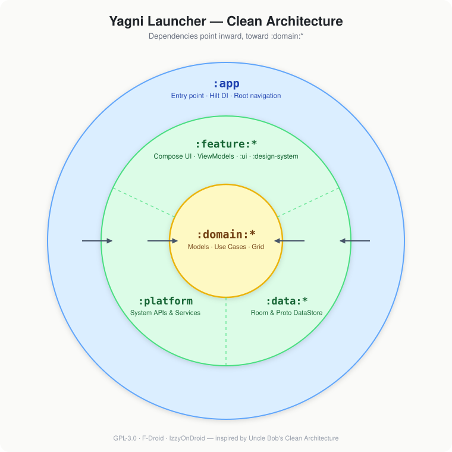

# Yagni Launcher Architecture

This document describes Yagni Launcher's Gradle module responsibilities and dependency rules. The architecture is inspired by Clean Architecture, but the module boundaries are pragmatic rather than a strict one-to-one mapping to concentric layers.

This module structure follows [The Clean Architecture](https://blog.cleancoder.com/uncle-bob/2012/08/13/the-clean-architecture.html)

---

## Table of Contents

- [Clean Architecture Layers](#clean-architecture-layers)
- [Dependency Rule](#dependency-rule)
- [Module Groups](#module-groups)
    - [Domain](#domain)
    - [Data](#data)
    - [Platform](#platform)
    - [Presentation](#presentation)
    - [Android Entry Points](#android-entry-points)
    - [Shared Infrastructure](#shared-infrastructure)
- [design-system, ui, and feature:* Boundaries](#design-system-ui-and-feature-boundaries)
- [Further Reading](#further-reading)

---

## Clean Architecture Layers

The codebase has five main groups:

1. **Domain** — Pure Kotlin models, repository and platform contracts, use cases, and grid algorithms. No Android SDK imports.
2. **Data** — Persistence implementations: Room database, Proto DataStore preferences, and the repositories that combine them.
3. **Platform** — Android system integrations and other platform-specific implementations. It implements Domain contracts where needed and exposes Android-facing wrappers to consumers that require them. This includes Android Service components (accessibility and notification listener).
4. **Presentation** — Compose UI and ViewModels: the `feature:*` screens plus the `ui` and `design-system` component libraries.
5. **Android Entry Points** — `app`, which provides the Application, Activity, and root navigation graph.

## Dependency Rule

Domain remains independent of Android, Data, Platform, Presentation, and the entry points. Data and Platform depend on Domain contracts; Presentation uses Domain and the platform APIs it needs; `app` composes the application graph. This is a pragmatic modular architecture: Presentation can consume platform wrappers, while the Domain itself remains Android-independent.

## Module Groups

### Domain

Pure Kotlin modules with no Android dependency, so their logic is fully unit-testable in isolation:

| Module              | Responsibility                                                                                           |
|---------------------|----------------------------------------------------------------------------------------------------------|
| `domain:model`      | Entity and value-object definitions shared by other layers.                                              |
| `domain:repository` | Repository interfaces describing required data operations; implemented by `data:repository`.             |
| `domain:platform`   | Android-independent contracts for platform capabilities needed by the Domain; implemented by `platform`. |
| `domain:use-case`   | Application business logic composed from repositories and platform contracts.                            |
| `domain:grid`       | Grid layout and collision-resolution algorithms used when moving or resizing items.                      |
| `domain:common`     | Cross-cutting contracts and qualifiers, including coroutine dispatcher qualifiers.                       |

### Data

Concrete persistence implementations behind the `domain:repository` interfaces:

| Module                 | Responsibility                                                                          |
|------------------------|-----------------------------------------------------------------------------------------|
| `data:repository`      | Repository implementations that combine `data:room` and `data:datastore` sources.       |
| `data:room`            | The local SQLite database (grid items, installed apps, widgets, shortcuts, icon packs). |
| `data:datastore`       | User settings persistence via Proto DataStore.                                          |
| `data:datastore-proto` | The `.proto` schema definitions consumed by `data:datastore`.                           |

### Platform

`platform` is an Android library that owns integrations with system APIs such as `LauncherApps`, `PackageManager`, `WallpaperManager`, `AppWidgetManager`, accessibility, locale, and notifications. It also owns Android-specific image serialization, material color-scheme resolution, file management, and icon-key generation.

Additionally, it contains Android Service components:
- `EblanAccessibilityService` — global actions via accessibility
- `EblanNotificationListenerService` — notification counts

`domain:platform` contains Android-independent contracts needed by domain logic. The `platform` module implements and binds the relevant contracts. Some Android-facing wrapper interfaces also live in `platform` for consumers such as `ui`.

### Presentation

| Module                                                                                         | Responsibility                                            |
|------------------------------------------------------------------------------------------------|-----------------------------------------------------------|
| `feature:*` (`home`, `action`, `pin`, `edit-application-info`, `edit-grid-item`, `settings:*`) | Feature-specific screens, ViewModels, and UI state.       |
| `design-system`                                                                                | Generic, model-free Compose primitives.                   |
| `ui`                                                                                           | Shared, application-aware UI reused by multiple features. |

### Android Entry Points

`app` is the application composition root.

| Module | Responsibility                                                                                          |
|--------|---------------------------------------------------------------------------------------------------------|
| `app`  | Application composition root: Hilt setup, `Application`, Activities, and the root navigation graph.     |

### Shared Infrastructure

| Module        | Responsibility                                                                                            |
|---------------|-----------------------------------------------------------------------------------------------------------|
| `common`      | Shared coroutine dispatcher providers.                                                                  |
| `build-logic` | Gradle convention plugins that standardize module build configuration.                                    |

---

## design-system, ui, and feature:* Boundaries

These three module groups all sit in the Presentation layer, but each has a distinct responsibility:

- **`design-system`** contains generic, reusable visual primitives — theming, icons, animations, dialogs, and other Compose building blocks that carry no knowledge of the launcher's domain models or features. It is model-free: it has no dependency on `domain:model` or any other domain module.
- **`ui`** contains shared, *application-aware* UI: composites built from `design-system` primitives that are reused across features (dialogs, settings composables, etc.). It exposes `platform` as an API dependency.
- **`feature:*`** modules contain screens, ViewModels, and UI state specific to one feature. They depend on both `design-system` and `ui` (added automatically by the Android feature convention plugin), plus the `domain:*` modules they use directly.

---

## Further Reading

Yagni Launcher uses its own Clean Architecture and module dependency rules, as described throughout this document. Now in Android only influenced selected tooling and Gradle module terminology — for example `build-logic`, `design-system`, and `ui` — and the link below does not mean that Yagni Launcher's architecture is based on that project.

- [The Clean Architecture](https://blog.cleancoder.com/uncle-bob/2012/08/13/the-clean-architecture.html)
- [Now in Android modularization guide](https://github.com/android/nowinandroid/blob/main/docs/ModularizationLearningJourney.md)